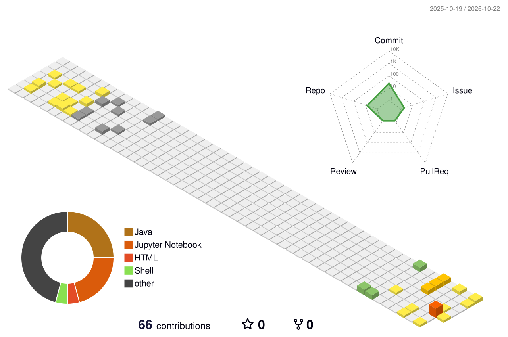

  <h2>Hello World,  ฅ(^ω^ฅ)!</h2>

[Website](https://dnngw.github.io) •
[Linkedin](https://www.linkedin.com/in/dnngw/) •
[Email](mailto:danangwijayanto507@gmail.com) 

  

 
 
<table align="center">
  <tr>
    <td width="50%" align="center">
      <picture>
        <source media="(prefers-color-scheme: dark)" srcset="./dist/github-snake-dark.svg" />
        <source media="(prefers-color-scheme: light)" srcset="./dist/github-snake.svg" />
        
      </picture>
    </td>
    <td width="50%" align="center">
      
    </td>
  </tr>
</table>

